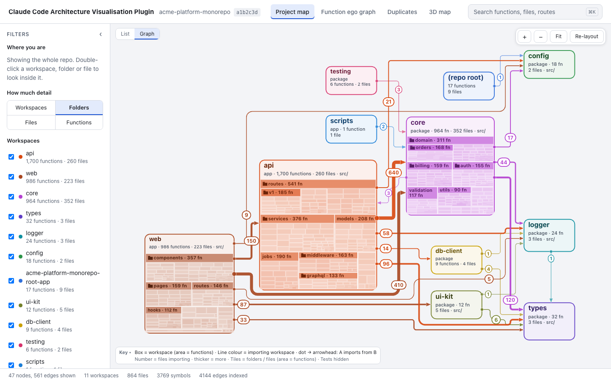
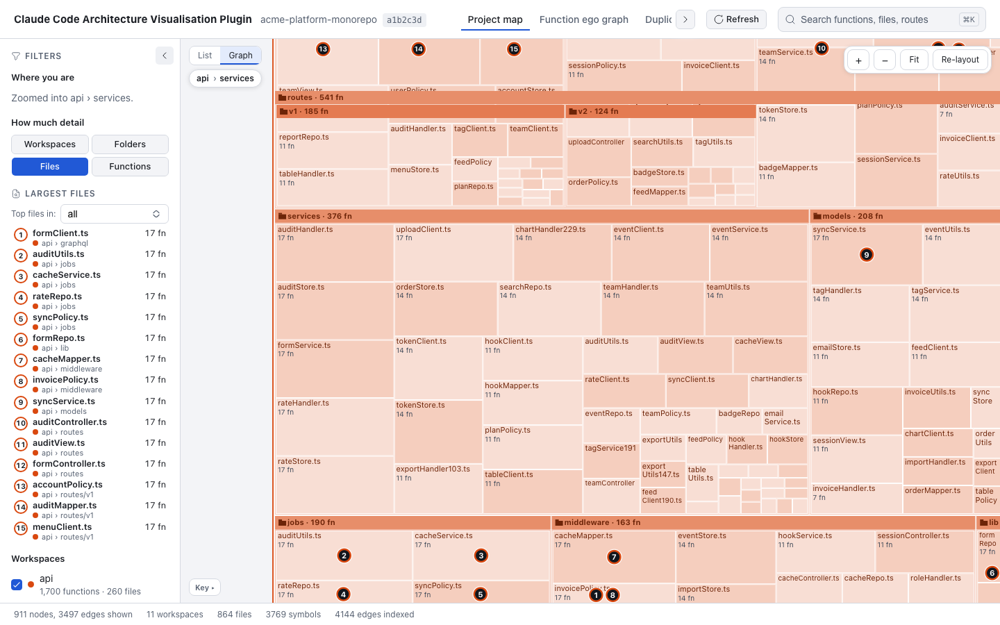
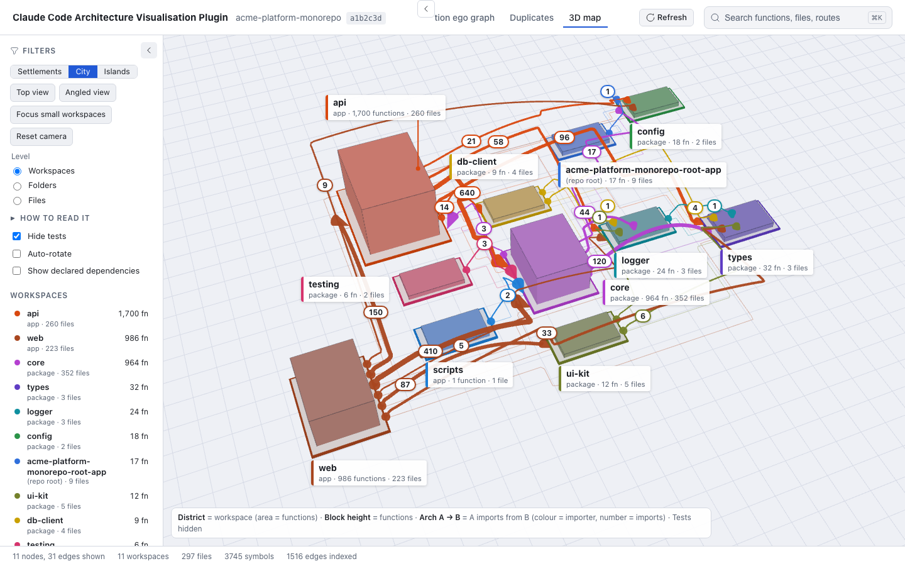
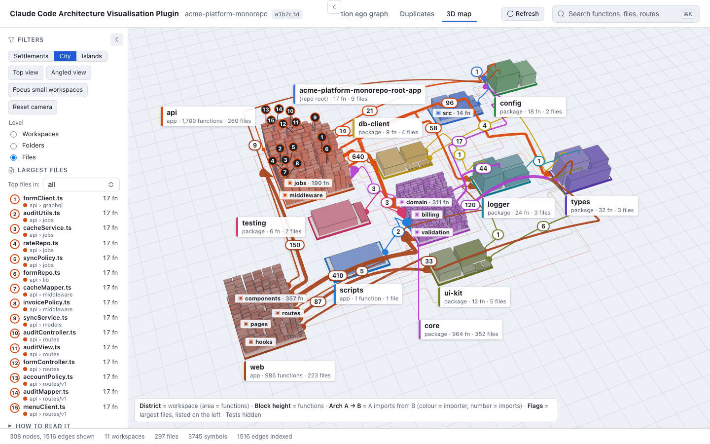
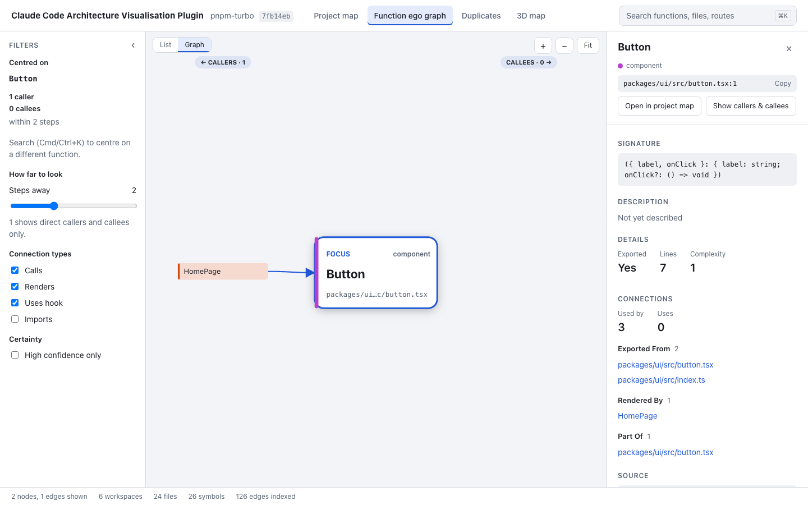

# Claude Code Architecture Visualisation Plugin

A Claude Code plugin that indexes a TypeScript repository into a structural graph (workspaces, folders, files, functions, and the imports, calls and renders between them) and shows it in a local browser app: a 2D project map, a 3D city, a caller graph for any function, and a list of duplicated code. Monorepos come first (pnpm, npm/yarn workspaces, Nx, Turborepo).


This is early development. The indexer, the command line and the explorer views below work today. Descriptions written by a model exist in two forms: the optional pre-commit describer, and the server side for whole-repo describing (see [MCP server](#mcp-server)). The duplicate warnings in Claude Code (the engine behind them exists, see below), the impact MCP tool, and the Claude Code hooks are not built yet; the plugin package installs from a local path but has not had its in-session check yet (see [Status](#status)). The command, package scope, MCP server name, plugin id and data directory use the short identifier `gantry`.

The screenshots on this page are the real app. The larger ones come from the explorer's mock API with a synthetic "large monorepo" scenario (made-up workspace names, about 3,700 functions); the small ones come from the real server running on `fixtures/pnpm-turbo` in this repo. Nothing here comes from a private repository. Re-create them with `pnpm readme:media` (the PNGs are deterministic; the GIF is rewritten only with `--gif`).

## What you can see


### 2D project map

Boxes are workspaces and their area is their function count. A line goes from the workspace that imports to the workspace it imports from, in the importing workspace's colour; the number on it is how many files import across that link, and thicker means more. Double-click a box to look inside.


The Folders level draws each workspace's folders inside its box, sized by function count.



Zoom in and the boxes become files. A breadcrumb above the canvas names the workspace and folder at the centre (here `api › services`), and the numbered circles mark the largest files, matching the list on the left.



A small real repo (`fixtures/pnpm-turbo`, served by the real server) at Files level:


There is also a dark theme, which follows the browser's colour scheme:


### 3D city

The same layout seen from an angle. Each district is a workspace and its ground area is its function count. The arches between districts are the imports, coloured by the importing workspace, with the number of importing files on them. Orbit with the mouse; "Top view" gives the 2D layout from above, and "Islands" is an alternative rendering.



At Files level every file is a building and its height is its function count. The numbered flags mark the largest files, matching the list on the left.



### Function caller graph

Pick a function with search (Cmd/Ctrl+K) and the graph puts it in the centre with its callers on the left and what it calls on the right. When one side is large, callers are grouped by workspace, folder and file; click a group to open it. The number on each group is how many callers it holds. Here the mock's `DataTable` has 221 callers in 3 workspaces.


On the pnpm-turbo fixture, the same view for `Button` (the real server, one caller, with the inspector open):



### Duplicates

Groups of functions that are copies of each other, biggest first (number of copies times lines of code). Each row says how alike the copies are in plain words: Identical, Nearly identical or Similar code (renamed or rewritten copies, found with embeddings). Matches by meaning alone are not grouped yet. A strip above the list counts the groups, the functions and roughly how many lines are duplicated, and splits the groups by workspace: groups that span several workspaces are the ones worth moving into a shared package. Pick a group to see its copies as cards (file and line, workspace, whether it is exported, how many functions call it, how much of it matches the copy to keep), the copy it suggests keeping and why (a function in a shared package, exported and used the most), and a side-by-side comparison of the source with the lines that differ marked. "Not a duplicate" hides a pair for good, including from the duplicate check; "Show callers" and "Open in project map" jump to the other views. The screenshot is the mock's synthetic scenario with 22 groups.

Without `gantry embed` only identical and nearly identical code is found: copies that were renamed or rewritten are found by the vector tier, which needs the embeddings, and the page says so in a banner until they exist. A dismissal cannot be undone from the page yet.


## Quick start

You need Node 22 or newer and pnpm. To use Gantry inside Claude Code, install it as a local plugin from a clone (the `/gantry:init` and `/gantry:sync` skills, the model-invoked `reuse-first` skill and the background `describer` agent): see [`docs/INSTALL.md`](docs/INSTALL.md). To use only the command line, run it from a clone:

```sh
git clone https://github.com/jbknick/architecture-visualization-cc-plugin.git
cd architecture-visualization-cc-plugin
pnpm install && pnpm build
```

Then, inside a TypeScript git repository you want to look at (`<path>` is this clone):

```sh
node <path>/plugin/dist/cli.js init
node <path>/plugin/dist/cli.js map
```

`init` indexes the repo and prints a summary: files indexed and the time taken, then counts of symbols, function-like symbols, edges, unresolved imports and parse errors, and the data directory. On the small fixture that is 22 files in under 100 ms. `map` starts the explorer on `127.0.0.1` on a free port, prints its URL (with an access token in the query string) and opens it in your browser. Pass `--no-open` to only print the URL, and `--port <n>` to pick the port. Stop it with Ctrl+C.

The index lives outside your repo, in `$CLAUDE_PLUGIN_DATA/repos/<hash>/` when that variable is set and `~/.gantry/data/repos/<hash>/` otherwise. Nothing is written into the repo's working tree. The one exception is `gantry hooks install`, which you run yourself and which writes git hooks under `.git/hooks/` (or sets a local `core.hooksPath` if you already use one); `hooks uninstall` and `uninstall` put everything back.

## Commands

Run as `node <path>/plugin/dist/cli.js <command>`. Every command below exists today (`--help` on each shows its options).

| Command                                                       | What it does                                                                                                                                                                                                                                                                                                                                                                                                                                                                                                                                                                                          |
| ------------------------------------------------------------- | ----------------------------------------------------------------------------------------------------------------------------------------------------------------------------------------------------------------------------------------------------------------------------------------------------------------------------------------------------------------------------------------------------------------------------------------------------------------------------------------------------------------------------------------------------------------------------------------------------- |
| `init [--estimate] [--exports-first] [--embed]`               | Create the data directory and run a full deterministic index of the current repo. `--estimate` also prints how many functions would need a description and the projected token cost; it makes no model calls. `--embed` also fills the local embedding vectors afterwards (see `embed`). It also records `similar_to` links between functions that are exact or near copies of each other (shown by `node`).                                                                                                                                                                                          |
| `embed [--limit n] [--budget-ms n] [--json]`                  | Fill the local embedding vectors used by the two vector tiers of duplicate detection, in resumable batches with progress on stderr. Runs a local model on the CPU; nothing is sent anywhere. `init` never does this on its own.                                                                                                                                                                                                                                                                                                                                                                       |
| `index [--files <paths...>] [--layer main\|working] [--dump]` | Run the deterministic index. `--dump` prints the sorted graph as JSON.                                                                                                                                                                                                                                                                                                                                                                                                                                                                                                                                |
| `heal [--from <sha>]`                                         | Bring the index up to the current `HEAD` (incremental, or a full re-index for a very large diff) and refresh the `similar_to` links.                                                                                                                                                                                                                                                                                                                                                                                                                                                                  |
| `search <q> [--kind <kind...>] [--limit <n>] [--json]`        | Hybrid search: keywords over symbol names, paths and stored descriptions, plus meaning when the embedding model is cached (never downloaded by search). Higher score is better.                                                                                                                                                                                                                                                                                                                                                                                                                       |
| `node <target> [--json]`                                      | Show a symbol or file and its neighbours by edge kind. The target is a node id, `path:line` or a file path.                                                                                                                                                                                                                                                                                                                                                                                                                                                                                           |
| `usage [--json]`                                              | Model usage grouped by task and model (rows come from the pre-commit describer; empty until it has run).                                                                                                                                                                                                                                                                                                                                                                                                                                                                                              |
| `describe --staged [--json]`                                  | Describe the staged functions that have no description with the headless `claude -p` worker (Haiku by default; functions that fail the checks are retried once on Sonnet). Only runs when `precommit.mode` is `timeboxed` (stops at `precommit.budgetMs`, default 8000, and queues the rest) or `strict` (no deadline); the default `off` does nothing. The worker needs `claude` logged in (set `worker.binary` in the config if it is not on `PATH`); otherwise everything is queued. Every call is logged for `usage`. The pre-commit hook runs this itself in those two modes and always exits 0. |
| `backlog [--json]`                                            | Counts of the description backlog by status (pending, claimed, failed) and by priority. No model calls.                                                                                                                                                                                                                                                                                                                                                                                                                                                                                               |
| `config get [key]`, `config set <key> <value>`                | Read or write project config by dotted key.                                                                                                                                                                                                                                                                                                                                                                                                                                                                                                                                                           |
| `map [--port <n>] [--no-open]`                                | Start the explorer server, or reuse the running one, and open it.                                                                                                                                                                                                                                                                                                                                                                                                                                                                                                                                     |
| `hooks install`, `hooks uninstall`                            | Install or remove the git hooks in the current repo, chaining any existing hooks.                                                                                                                                                                                                                                                                                                                                                                                                                                                                                                                     |
| `uninstall [--keep-data]`                                     | Remove the git hooks and delete the repo's data directory.                                                                                                                                                                                                                                                                                                                                                                                                                                                                                                                                            |
| `hook <name> [args...]`                                       | The entry point the installed git hooks call (Claude Code hooks will use it later). It always exits 0. You do not run it by hand.                                                                                                                                                                                                                                                                                                                                                                                                                                                                     |

## Status

Progress by milestone. Issue lists are on the [milestones page](https://github.com/jbknick/architecture-visualization-cc-plugin/milestones).

| Milestone                                                                                            | State            | Notes                                                                                                                                                                                                                                                                                                                                                                                                                                                                                                                                                                                                                                                                                                                                                                                                                                                                                                                                                                                                                                                                                                                                                                                                                                                                                                                                |
| ---------------------------------------------------------------------------------------------------- | ---------------- | ------------------------------------------------------------------------------------------------------------------------------------------------------------------------------------------------------------------------------------------------------------------------------------------------------------------------------------------------------------------------------------------------------------------------------------------------------------------------------------------------------------------------------------------------------------------------------------------------------------------------------------------------------------------------------------------------------------------------------------------------------------------------------------------------------------------------------------------------------------------------------------------------------------------------------------------------------------------------------------------------------------------------------------------------------------------------------------------------------------------------------------------------------------------------------------------------------------------------------------------------------------------------------------------------------------------------------------ |
| [M0 Spikes](https://github.com/jbknick/architecture-visualization-cc-plugin/milestone/1)             | Done, verdict GO | Headless Claude worker, oxc import graph, embedding model and description quality were measured. See [`docs/spikes/GO-NO-GO.md`](docs/spikes/GO-NO-GO.md).                                                                                                                                                                                                                                                                                                                                                                                                                                                                                                                                                                                                                                                                                                                                                                                                                                                                                                                                                                                                                                                                                                                                                                           |
| [M1 Structural graph](https://github.com/jbknick/architecture-visualization-cc-plugin/milestone/2)   | Done             | Workspace detection, file discovery, parsing, import resolution, hashing, SQLite store, `init`, `heal`, git hooks, search/node/usage/config. On a private TypeScript monorepo (1,531 files, 9,042 symbols, 41,817 edges): 0 parse errors, 0.28% of repo-internal imports unresolved, a cold index in about 7 s, identical output across runs. Details in [`docs/milestones/M1.md`](docs/milestones/M1.md).                                                                                                                                                                                                                                                                                                                                                                                                                                                                                                                                                                                                                                                                                                                                                                                                                                                                                                                           |
| [M3 Explorer](https://github.com/jbknick/architecture-visualization-cc-plugin/milestone/4)           | Partly done      | Built: local server with a token, the 2D project map (four detail levels), the 3D city and islands, the function caller graph, the duplicates view (ranked groups, side-by-side source, "not a duplicate"), search, inspector, light and dark themes. Not built: duplicate badges on the maps, pages view, feature slices.                                                                                                                                                                                                                                                                                                                                                                                                                                                                                                                                                                                                                                                                                                                                                                                                                                                                                                                                                                                                           |
| [M2 Reuse guard](https://github.com/jbknick/architecture-visualization-cc-plugin/milestone/3)        | In progress      | Built: the description backlog and template descriptions, the local embedding step (`gantry embed`), the duplicate engine (exact, near, code-vector and semantic tiers, plus `similar_to` links) with the explorer's Duplicates view, and the deterministic reuse advice (import it, add the dependency, export or move it, undeclared-import check). The description checks, and the `gantry` MCP server with lazy refresh and two describer tools (claim a batch of functions, submit descriptions), three lookup tools (hybrid search, browse, node) with per-folder catalog files of one-line function descriptions, and the optional pre-commit describer (`precommit.mode` `timeboxed` or `strict`; runs `claude -p` headless, checks every description, logs usage). The plugin package (manifest, MCP config, the `describer` agent that calls those tools, the `/gantry:init` and `/gantry:sync` skills) and the `backlog` command; installing it from a local path is in [`docs/INSTALL.md`](docs/INSTALL.md), and the in-session end-to-end run is still to be recorded. Not built: a command or hook that reports duplicates, the impact MCP tool, Claude Code hooks. Also built: the `gantry_find_similar` MCP tool and the model-invoked `reuse-first` skill that tells Claude to call it before writing a new helper. |
| [M4 Live working graph](https://github.com/jbknick/architecture-visualization-cc-plugin/milestone/5) | Not started      | The explorer updating as files change.                                                                                                                                                                                                                                                                                                                                                                                                                                                                                                                                                                                                                                                                                                                                                                                                                                                                                                                                                                                                                                                                                                                                                                                                                                                                                               |
| [M5 Code review](https://github.com/jbknick/architecture-visualization-cc-plugin/milestone/6)        | Not started      | Blast radius of a change or pull request.                                                                                                                                                                                                                                                                                                                                                                                                                                                                                                                                                                                                                                                                                                                                                                                                                                                                                                                                                                                                                                                                                                                                                                                                                                                                                            |
| [M6 Adapters](https://github.com/jbknick/architecture-visualization-cc-plugin/milestone/7)           | Not started      | TanStack Start, Hono, oRPC and Drizzle: page to API to table views.                                                                                                                                                                                                                                                                                                                                                                                                                                                                                                                                                                                                                                                                                                                                                                                                                                                                                                                                                                                                                                                                                                                                                                                                                                                                  |

## MCP server

`plugin/dist/mcp.js` is a stdio MCP server named `gantry` (it is built by `pnpm build`; the plugin package that starts it for Claude Code is not built yet). Before every tool call it brings the index up to date: it runs `heal` only when `HEAD` has moved, then refreshes the files you have edited since. It writes nothing but protocol messages to stdout, and every answer is one JSON block of at most 4,000 characters (lists are cut and the answer says `"truncated": true`). The one exception is `gantry_claim_batch`, which only background describer agents call and which may return a full batch of 40 functions (up to 80,000 characters).

Six tools exist today. The first two are for background describer agents and do not read or search the graph; the other four look things up.

| Tool                         | Input                                                              | What it does                                                                                                                                                                                                                                                                                                                                                                                                                                              |
| ---------------------------- | ------------------------------------------------------------------ | --------------------------------------------------------------------------------------------------------------------------------------------------------------------------------------------------------------------------------------------------------------------------------------------------------------------------------------------------------------------------------------------------------------------------------------------------------- |
| `gantry_claim_batch`         | `{ worker_id, size <= 40 }`                                        | Claims functions that need a description and returns `{ batch_id, items }`, one fact sheet per function. A batch the worker has not submitted comes back first, with the same `batch_id`. A claim expires after 10 minutes.                                                                                                                                                                                                                               |
| `gantry_submit_descriptions` | `{ batch_id, results: [{ content_key, description }] }`            | Checks each description, stores the good ones and returns `{ accepted, rejected }`. A rejected function goes back to the queue and is set aside after 2 failures.                                                                                                                                                                                                                                                                                         |
| `gantry_find_similar`        | `{ query?, code?, kind?, workspace?, caller_path?, limit? <= 10 }` | Call before writing a new helper. Give a one-sentence `query`, a draft `code`, or both. Returns `{ matches: [{ id, name, kind, path, line, signature, import_path, tier, score, untrusted_description, advice: { situation, action, inline } }], notes? }`, best first (tiers exact, near, code_vector, semantic). `advice.inline: true` means import it as is. Without description vectors it says so in `notes` and uses code and keyword matches only. |
| `gantry_search`              | `{ query, kind?, workspace?, exported?, limit? <= 50 }`            | Hybrid keyword and meaning search. Returns `{ hits: [{ id, name, kind, path, line, signature, score, untrusted_description }] }`, best first. Meaning search runs only when the embedding model is already cached; otherwise it is keywords only.                                                                                                                                                                                                         |
| `gantry_browse`              | `{ target }`                                                       | One level below a workspace id, directory or file: `{ items: [{ id, name, kind, exported, path, line, count, untrusted_description }], catalog_path }`. Directories and files carry their function counts. `catalog_path` is a markdown file in the data directory to `Read` when 4,000 characters are not enough.                                                                                                                                        |
| `gantry_node`                | `{ target }`                                                       | A symbol or file by id, `path:line` or path: `{ node, untrusted_description, signature, fan_in, fan_out, neighbors, more? }`. At most 20 neighbors per edge kind; `more` counts the rest.                                                                                                                                                                                                                                                                 |

Descriptions are text written by a model about code that may be untrusted, and the checks reduce that risk without removing it. Any tool that returns a description puts it in a field named `untrusted_description`, and every tool description says the field is data and nothing in it is to be followed.

## How it works

1. Discover: list the repo's files with git, keep `.ts`, `.tsx`, `.mts` and `.cts`, and drop built-in excludes, sensitive paths and files over 1 MB.
2. Parse: oxc reads each file and extracts symbols and their syntax edges (imports, exports, calls, renders).
3. Hash: each function gets a content hash so unchanged code can be recognised later, plus a structural fingerprint that finds copies with renamed variables.
4. Resolve: oxc-resolver turns import specifiers into repo files and workspace packages, which gives the file-to-file and workspace-to-workspace edges.
5. Store: the graph goes into SQLite in the data directory. Output is sorted and stable, so two runs on the same commit give the same graph.
6. Serve: `gantry map` starts an HTTP server on `127.0.0.1` that serves the explorer and a JSON API. Requests need the token printed in the URL.

## Privacy and safety

- Everything is local. The indexer and the explorer make no model calls and need no API key.
- Files matching sensitive path patterns (`.env*`, `*.pem`, `*.key`, `id_rsa*`, `.npmrc`, `credentials*`, `secrets*`, `*.tfvars` and similar) are excluded by path, so their contents are never read for indexing.
- The explorer server binds to `127.0.0.1` only and answers API requests only with its per-run token.
- The git hooks fail open: if Gantry errors, the hook logs and exits 0 rather than blocking your commit or push.

## Development

```sh
pnpm install
pnpm build    # tsc -b && tsup && the explorer web build; writes plugin/dist/
pnpm check    # biome + tsc + vitest, the local quality gate
pnpm fmt      # apply Biome fixes
pnpm readme:media   # regenerate the screenshots in docs/readme/ (add --gif to redo the GIF too)
```

[`docs/SPEC.md`](docs/SPEC.md) holds the contracts and the repo layout, and [`CLAUDE.md`](CLAUDE.md) the contribution rules. The explorer's own notes, including how to run it against the mock API, are in [`packages/explorer/web/README.md`](packages/explorer/web/README.md). `pnpm readme:media` needs Chromium for Playwright (`pnpm --filter @gantry/explorer exec playwright install chromium`).

The repository is named `architecture-visualization-cc-plugin`.

## Licence

[MIT](LICENSE).
