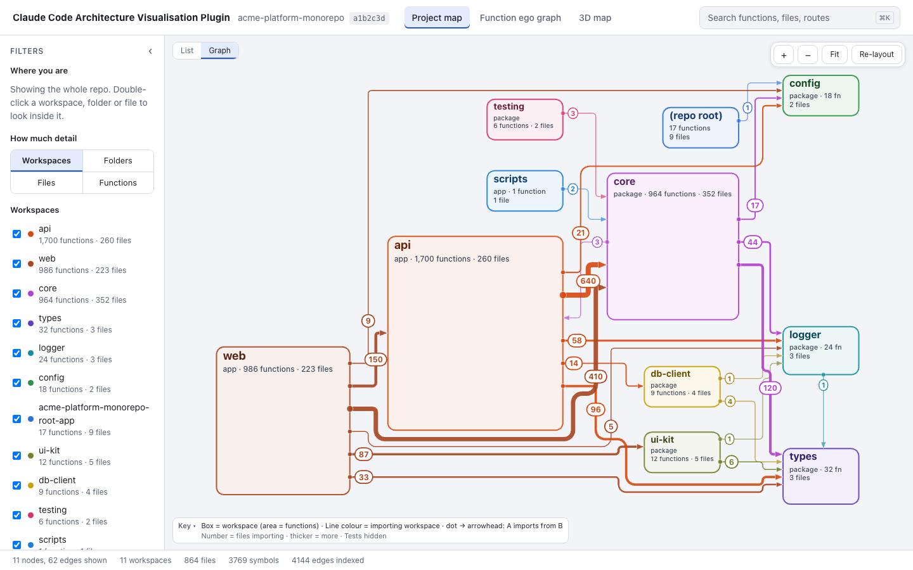
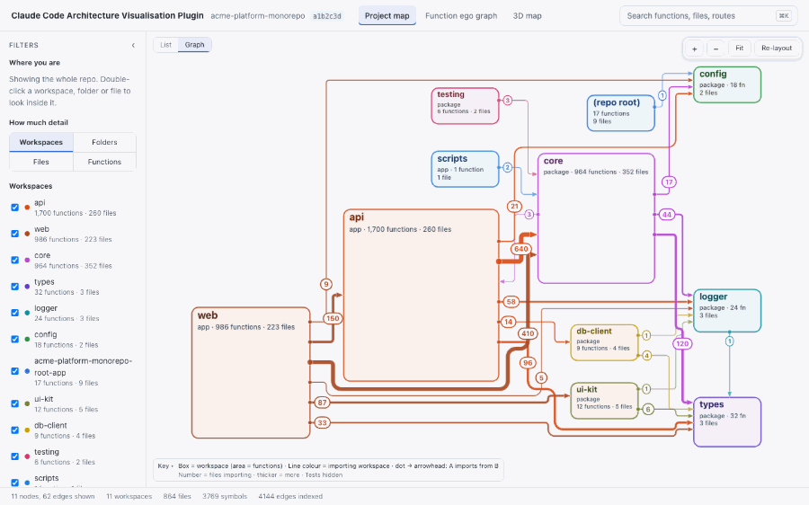
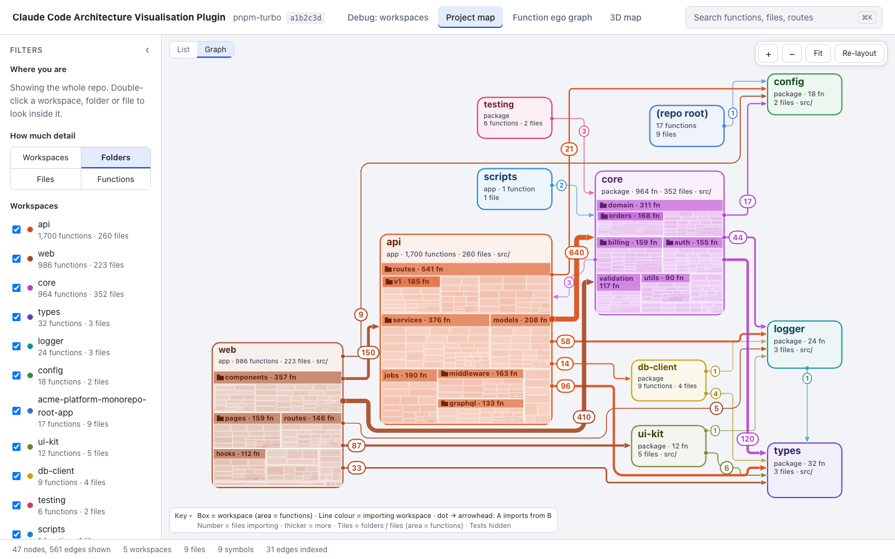
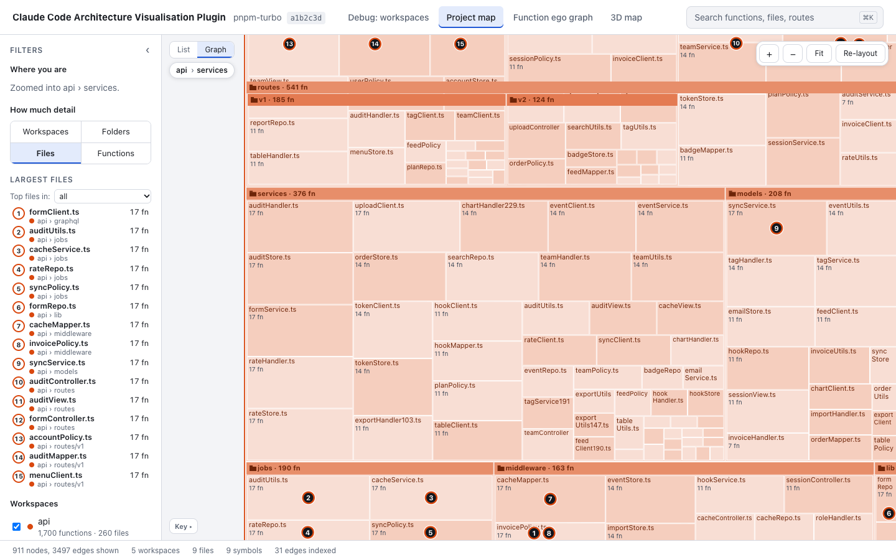
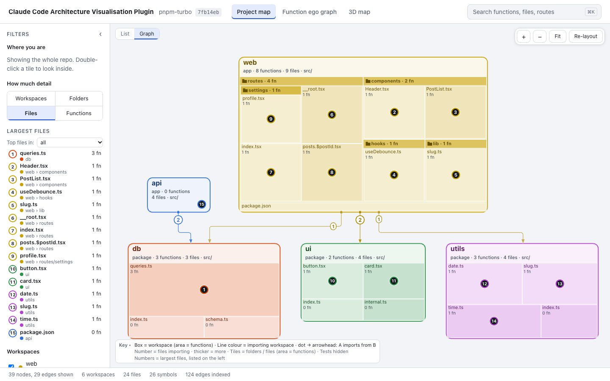
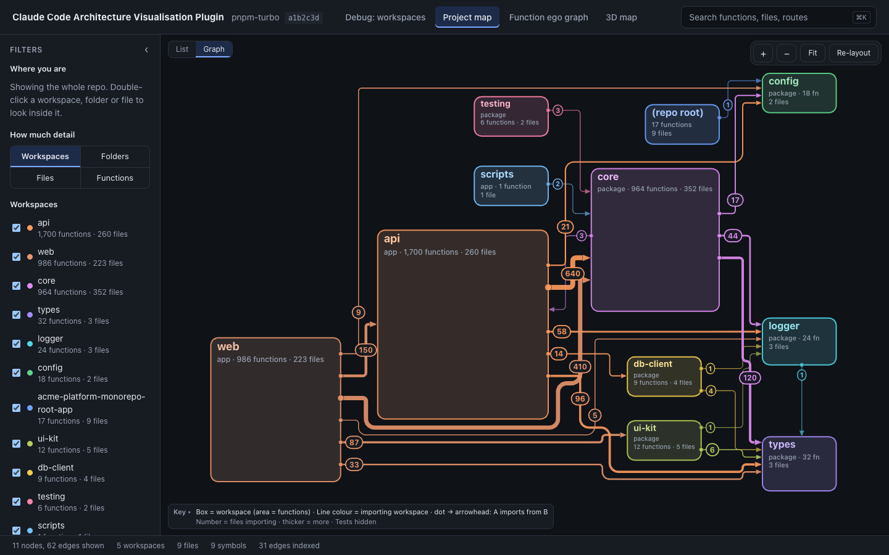
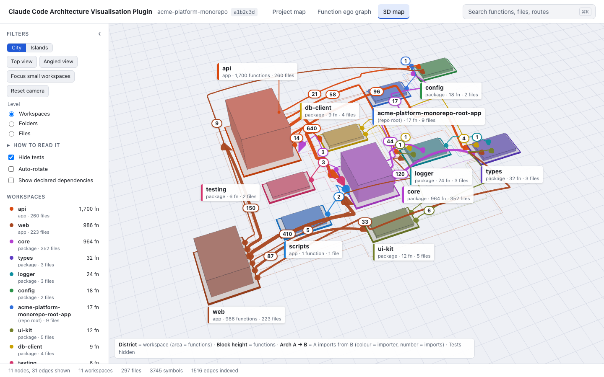
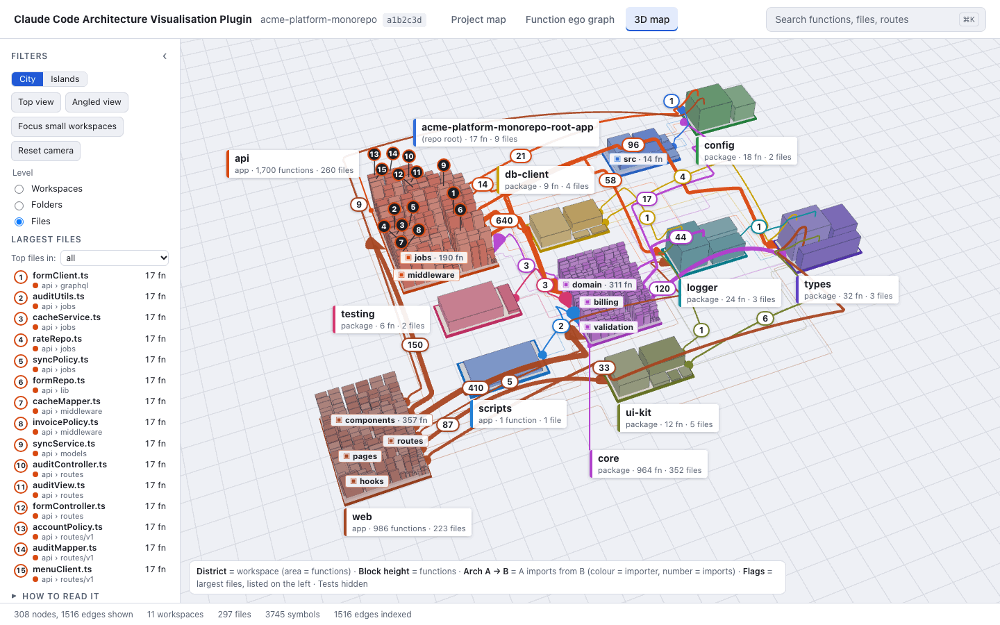
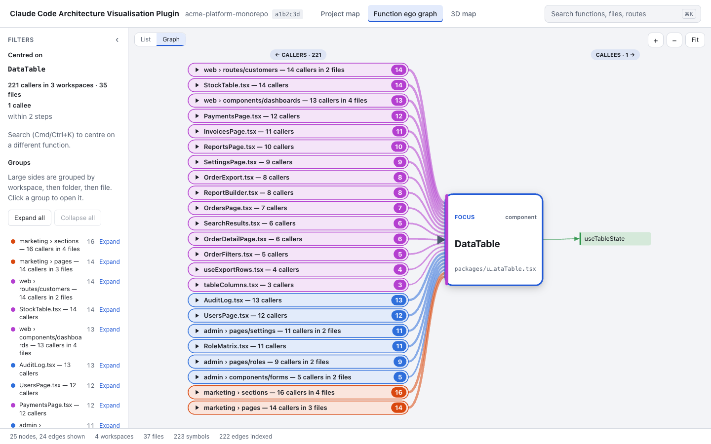
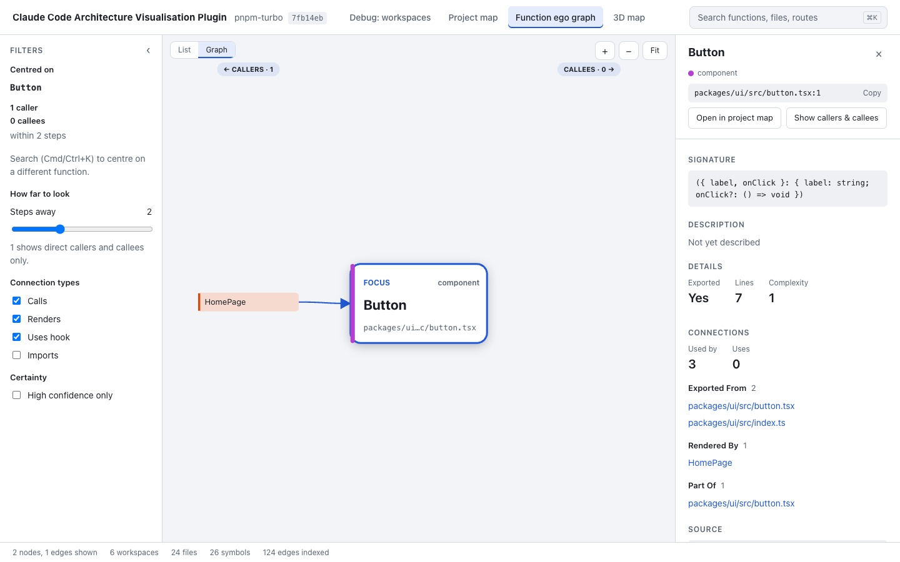

# Claude Code Architecture Visualisation Plugin

A Claude Code plugin that indexes a TypeScript repository into a structural graph (workspaces, folders, files, functions, and the imports, calls and renders between them) and shows it in a local browser app: a 2D project map, a 3D city, and a caller graph for any function. Monorepos come first (pnpm, npm/yarn workspaces, Nx, Turborepo).



This is early development. The indexer, the command line and the explorer views below work today. Descriptions written by a model, duplicate detection, the MCP tools, the Claude Code hooks and the installable plugin package are not built yet (see [Status](#status)). The command, package scope, MCP server name, plugin id and data directory use the short identifier `gantry`.

The screenshots on this page are the real app. The larger ones come from the explorer's mock API with a synthetic "large monorepo" scenario (made-up workspace names, about 3,700 functions); the small ones come from the real server running on `fixtures/pnpm-turbo` in this repo. Nothing here comes from a private repository. Re-create them with `pnpm readme:media`.

## What you can see



### 2D project map

Boxes are workspaces and their area is their function count. A line goes from the workspace that imports to the workspace it imports from, in the importing workspace's colour; the number on it is how many files import across that link, and thicker means more. Double-click a box to look inside.


The Folders level draws each workspace's folders inside its box, sized by function count.



Zoom in and the boxes become files. A breadcrumb above the canvas names the workspace and folder at the centre (here `api › services`), and the numbered circles mark the largest files, matching the list on the left.



A small real repo (`fixtures/pnpm-turbo`, served by the real server) at Files level:



There is also a dark theme, which follows the browser's colour scheme:



### 3D city

The same layout seen from an angle. Each district is a workspace and its ground area is its function count. The arches between districts are the imports, coloured by the importing workspace, with the number of importing files on them. Orbit with the mouse; "Top view" gives the 2D layout from above, and "Islands" is an alternative rendering.



At Files level every file is a building and its height is its function count. The numbered flags mark the largest files, matching the list on the left.



### Function caller graph

Pick a function with search (Cmd/Ctrl+K) and the graph puts it in the centre with its callers on the left and what it calls on the right. When one side is large, callers are grouped by workspace, folder and file; click a group to open it. The number on each group is how many callers it holds. Here the mock's `DataTable` has 221 callers in 3 workspaces.



On the pnpm-turbo fixture, the same view for `Button` (the real server, one caller, with the inspector open):



## Quick start

You need Node 22 or newer and pnpm. The plugin is not packaged yet, so run it from a clone:

```sh
git clone https://github.com/jbknick/architecture-visualization-cc-plugin.git
cd architecture-visualization-cc-plugin
pnpm install && pnpm build
```

Then, inside a TypeScript git repository you want to look at (`<path>` is this clone):

```sh
node <path>/plugin/dist/cli.js init
node <path>/plugin/dist/cli.js map
```

`init` indexes the repo and prints a summary: files indexed and the time taken, then counts of symbols, function-like symbols, edges, unresolved imports and parse errors, and the data directory. On the small fixture that is 22 files in under 100 ms. `map` starts the explorer on `127.0.0.1` on a free port, prints its URL (with an access token in the query string) and opens it in your browser. Pass `--no-open` to only print the URL, and `--port <n>` to pick the port. Stop it with Ctrl+C.

The index lives outside your repo, in `$CLAUDE_PLUGIN_DATA/repos/<hash>/` when that variable is set and `~/.gantry/data/repos/<hash>/` otherwise. Nothing is written into the repo's working tree. The one exception is `gantry hooks install`, which you run yourself and which writes git hooks under `.git/hooks/` (or sets a local `core.hooksPath` if you already use one); `hooks uninstall` and `uninstall` put everything back.

## Commands

Run as `node <path>/plugin/dist/cli.js <command>`. Every command below exists today (`--help` on each shows its options).

| Command                                                       | What it does                                                                                                                                                                                                                                                                             |
| ------------------------------------------------------------- | ---------------------------------------------------------------------------------------------------------------------------------------------------------------------------------------------------------------------------------------------------------------------------------------- |
| `init [--estimate] [--exports-first] [--embed]`               | Create the data directory and run a full deterministic index of the current repo. `--estimate` also prints how many functions would need a description and the projected token cost; it makes no model calls. `--embed` also fills the local embedding vectors afterwards (see `embed`). |
| `embed [--limit n] [--budget-ms n] [--json]`                  | Fill the local embedding vectors used for duplicate detection (not built yet), in resumable batches with progress on stderr. Runs a local model on the CPU; nothing is sent anywhere. `init` never does this on its own.                                                                 |
| `index [--files <paths...>] [--layer main\|working] [--dump]` | Run the deterministic index. `--dump` prints the sorted graph as JSON.                                                                                                                                                                                                                   |
| `heal [--from <sha>]`                                         | Bring the index up to the current `HEAD` (incremental, or a full re-index for a very large diff).                                                                                                                                                                                        |
| `search <q> [--kind <kind...>] [--limit <n>] [--json]`        | Full-text search over symbol names and paths.                                                                                                                                                                                                                                            |
| `node <target> [--json]`                                      | Show a symbol or file and its neighbours by edge kind. The target is a node id, `path:line` or a file path.                                                                                                                                                                              |
| `usage [--json]`                                              | Model usage grouped by task and model (empty until a model is used).                                                                                                                                                                                                                     |
| `config get [key]`, `config set <key> <value>`                | Read or write project config by dotted key.                                                                                                                                                                                                                                              |
| `map [--port <n>] [--no-open]`                                | Start the explorer server, or reuse the running one, and open it.                                                                                                                                                                                                                        |
| `hooks install`, `hooks uninstall`                            | Install or remove the git hooks in the current repo, chaining any existing hooks.                                                                                                                                                                                                        |
| `uninstall [--keep-data]`                                     | Remove the git hooks and delete the repo's data directory.                                                                                                                                                                                                                               |
| `hook <name> [args...]`                                       | The entry point the installed git hooks call (Claude Code hooks will use it later). It always exits 0. You do not run it by hand.                                                                                                                                                        |

## Status

Progress by milestone. Issue lists are on the [milestones page](https://github.com/jbknick/architecture-visualization-cc-plugin/milestones).

| Milestone                                                                                            | State            | Notes                                                                                                                                                                                                                                                                                                                                                                                                      |
| ---------------------------------------------------------------------------------------------------- | ---------------- | ---------------------------------------------------------------------------------------------------------------------------------------------------------------------------------------------------------------------------------------------------------------------------------------------------------------------------------------------------------------------------------------------------------- |
| [M0 Spikes](https://github.com/jbknick/architecture-visualization-cc-plugin/milestone/1)             | Done, verdict GO | Headless Claude worker, oxc import graph, embedding model and description quality were measured. See [`docs/spikes/GO-NO-GO.md`](docs/spikes/GO-NO-GO.md).                                                                                                                                                                                                                                                 |
| [M1 Structural graph](https://github.com/jbknick/architecture-visualization-cc-plugin/milestone/2)   | Done             | Workspace detection, file discovery, parsing, import resolution, hashing, SQLite store, `init`, `heal`, git hooks, search/node/usage/config. On a private TypeScript monorepo (1,531 files, 9,042 symbols, 41,817 edges): 0 parse errors, 0.28% of repo-internal imports unresolved, a cold index in about 7 s, identical output across runs. Details in [`docs/milestones/M1.md`](docs/milestones/M1.md). |
| [M3 Explorer](https://github.com/jbknick/architecture-visualization-cc-plugin/milestone/4)           | Partly done      | Built: local server with a token, the 2D project map (four detail levels), the 3D city and islands, the function caller graph, search, inspector, light and dark themes. Not built: duplicates view, pages view, feature slices.                                                                                                                                                                           |
| [M2 Reuse guard](https://github.com/jbknick/architecture-visualization-cc-plugin/milestone/3)        | Not started      | Descriptions written by Haiku (today the backlog and template descriptions exist, but no model is called), embeddings and duplicate detection, MCP server tools, Claude Code hooks, plugin packaging and skills.                                                                                                                                                                                           |
| [M4 Live working graph](https://github.com/jbknick/architecture-visualization-cc-plugin/milestone/5) | Not started      | The explorer updating as files change.                                                                                                                                                                                                                                                                                                                                                                     |
| [M5 Code review](https://github.com/jbknick/architecture-visualization-cc-plugin/milestone/6)        | Not started      | Blast radius of a change or pull request.                                                                                                                                                                                                                                                                                                                                                                  |
| [M6 Adapters](https://github.com/jbknick/architecture-visualization-cc-plugin/milestone/7)           | Not started      | TanStack Start, Hono, oRPC and Drizzle: page to API to table views.                                                                                                                                                                                                                                                                                                                                        |

## How it works

1. Discover: list the repo's files with git, keep `.ts`, `.tsx`, `.mts` and `.cts`, and drop built-in excludes, sensitive paths and files over 1 MB.
2. Parse: oxc reads each file and extracts symbols and their syntax edges (imports, exports, calls, renders).
3. Hash: each function gets a content hash so unchanged code can be recognised later.
4. Resolve: oxc-resolver turns import specifiers into repo files and workspace packages, which gives the file-to-file and workspace-to-workspace edges.
5. Store: the graph goes into SQLite in the data directory. Output is sorted and stable, so two runs on the same commit give the same graph.
6. Serve: `gantry map` starts an HTTP server on `127.0.0.1` that serves the explorer and a JSON API. Requests need the token printed in the URL.

## Privacy and safety

- Everything is local. The indexer and the explorer make no model calls and need no API key.
- Files matching sensitive path patterns (`.env*`, `*.pem`, `*.key`, `id_rsa*`, `.npmrc`, `credentials*`, `secrets*`, `*.tfvars` and similar) are excluded by path, so their contents are never read for indexing.
- The explorer server binds to `127.0.0.1` only and answers API requests only with its per-run token.
- The git hooks fail open: if Gantry errors, the hook logs and exits 0 rather than blocking your commit or push.

## Development

```sh
pnpm install
pnpm build    # tsc -b && tsup && the explorer web build; writes plugin/dist/
pnpm check    # biome + tsc + vitest, the local quality gate
pnpm fmt      # apply Biome fixes
pnpm readme:media   # regenerate the screenshots and GIF in docs/readme/
```

[`docs/SPEC.md`](docs/SPEC.md) holds the contracts and the repo layout, and [`CLAUDE.md`](CLAUDE.md) the contribution rules. The explorer's own notes, including how to run it against the mock API, are in [`packages/explorer/web/README.md`](packages/explorer/web/README.md). `pnpm readme:media` needs Chromium for Playwright (`pnpm --filter @gantry/explorer exec playwright install chromium`).

The repository is named `architecture-visualization-cc-plugin`.

## Licence

[MIT](LICENSE).
