# Claude Code Architecture Visualisation Plugin

A Claude Code plugin that indexes a TypeScript repository into a structural graph (workspaces, folders, files, functions, and the imports, calls and renders between them) and shows it in a local browser app: a 2D project map, a caller graph for any function, a list of duplicated code, the blast radius of a branch or pull request, and (just for fun) a 3D landscape of settlements joined by roads. Monorepos come first (pnpm, npm/yarn workspaces, Nx, Turborepo).

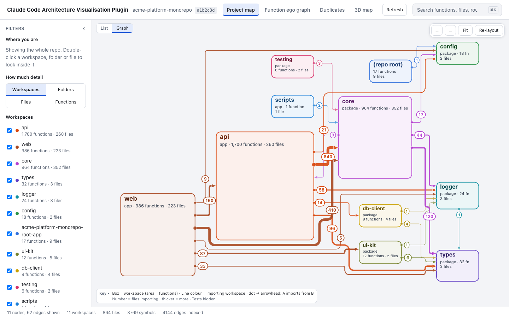

This is early development. The indexer, the command line and the explorer views below work today. Descriptions written by a model exist in two forms: the optional pre-commit describer, and the server side for whole-repo describing (see [MCP server](#mcp-server)). The plugin package with its Claude Code hooks (duplicate and undeclared-import notes after each edit) installs from a local path but has not had its in-session check yet (see [Status](#status)). The command, package scope, MCP server name, plugin id and data directory use the short identifier `gantry`.

The screenshots on this page are the real app. The larger ones come from the explorer's mock API with a synthetic "large monorepo" scenario (made-up workspace names, about 3,700 functions); the small ones come from the real server running on `fixtures/pnpm-turbo` in this repo. Nothing here comes from a private repository. Re-create them with `pnpm readme:media` (the PNGs are deterministic; the GIFs are rewritten only with `--gif`).

## What you can see

### 2D project map

Boxes are workspaces and their area is their function count. A line goes from the workspace that imports to the workspace it imports from, in the importing workspace's colour; the number on it is how many files import across that link, and thicker means more. Double-click a box to look inside.


The Folders level draws each workspace's folders inside its box, sized by function count.


Zoom in and the boxes become files. A breadcrumb above the canvas names the workspace and folder at the centre (here `api › services`), and the numbered circles mark the largest files, matching the list on the left.


A small real repo (`fixtures/pnpm-turbo`, served by the real server) at Files level:

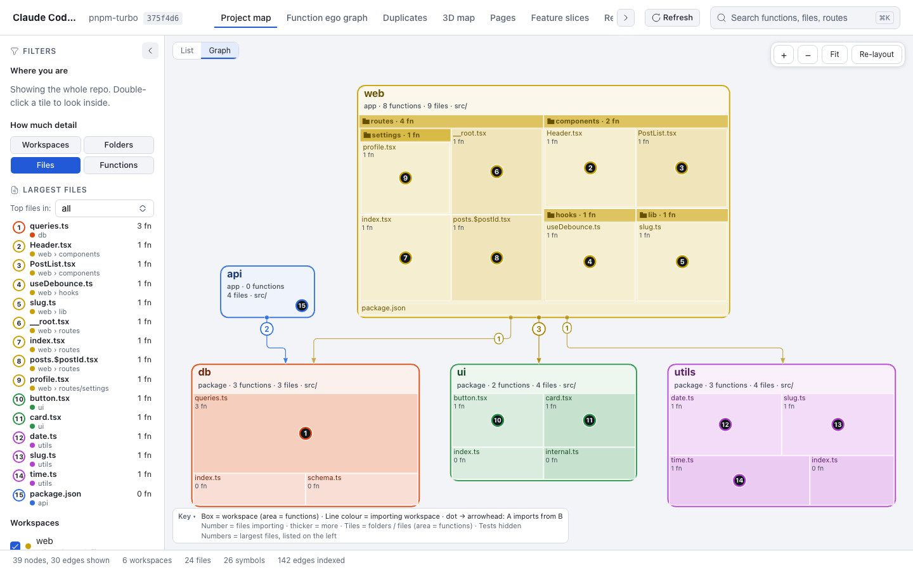

There is also a dark theme, which follows the browser's colour scheme:

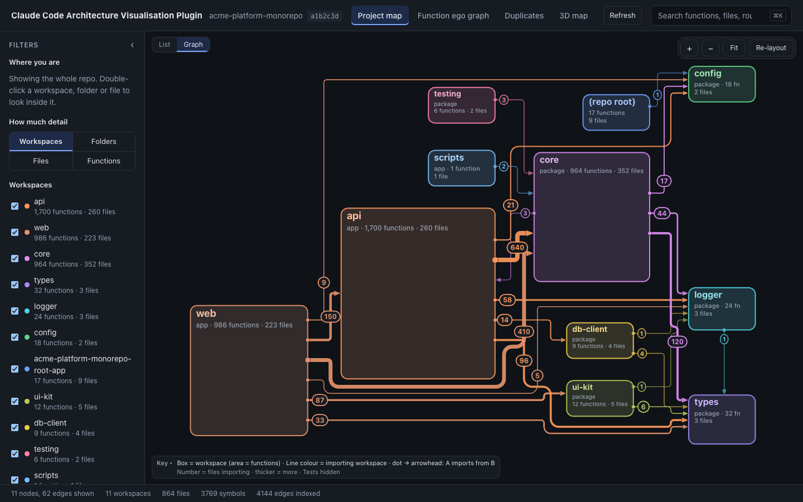

### Function caller graph

Pick a function with search (Cmd/Ctrl+K) and the graph puts it in the centre with its callers on the left and what it calls on the right. When one side is large, callers are grouped by workspace, folder and file; click a group to open it. The number on each group is how many callers it holds. Here the mock's `DataTable` has 221 callers in 3 workspaces.

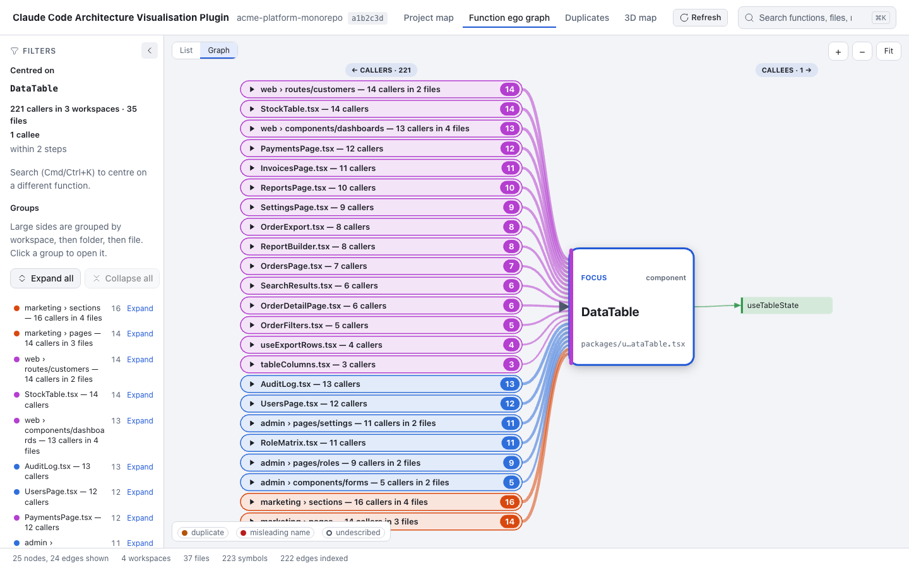

On the pnpm-turbo fixture, the same view for `Button` (the real server, one caller, with the inspector open):


### Duplicates

Groups of functions that are copies of each other, biggest first (number of copies times lines of code). Each row says how alike the copies are in plain words: Identical (also when only the function's own name differs), Nearly identical or Similar code (renamed or rewritten copies, found with embeddings). Matches by meaning alone are not grouped yet. A strip above the list counts the groups, the functions and roughly how many lines are duplicated, and splits the groups by workspace: groups that span several workspaces are the ones worth moving into a shared package. Pick a group to see its copies as cards (file and line, workspace, whether it is exported, how many functions call it, how much of it matches the copy to keep), the copy it suggests keeping and why (a function in a shared package, exported and used the most), and a side-by-side comparison of the source with the lines that differ marked. "Not a duplicate" hides a pair for good, including from the duplicate check; "Show callers" and "Open in project map" jump to the other views. The screenshot is the mock's synthetic scenario with 22 groups.

Without `gantry embed` only identical and nearly identical code is found: copies that were renamed or rewritten are found by the vector tier, which needs the embeddings, and the page says so in a banner until they exist. The page cannot undo a dismissal yet.

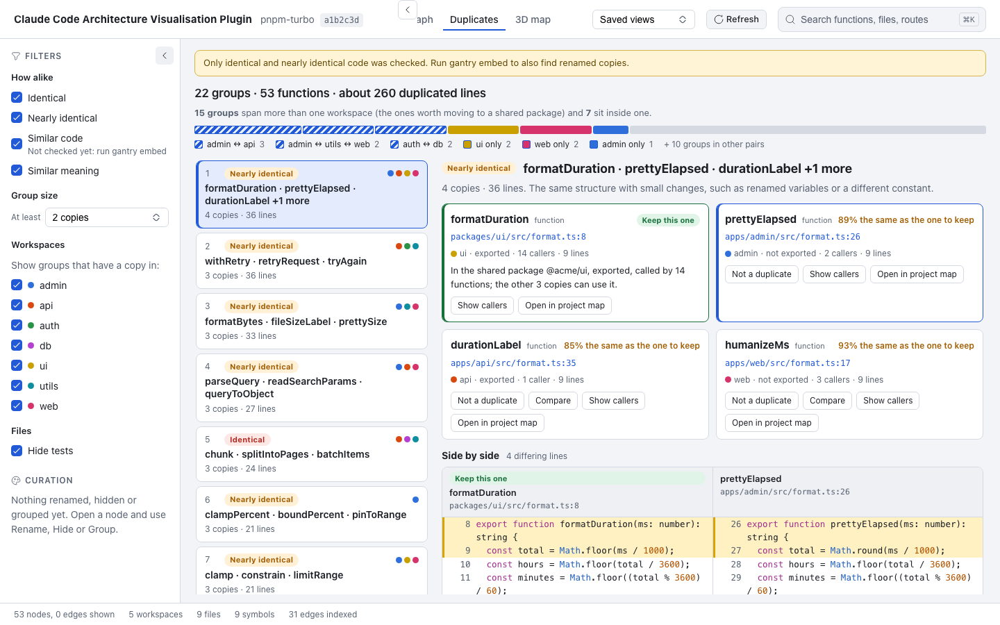

### Review (blast radius)

Give a range of commits (`main...feature`) or a pull request and the review is drawn on the project map you already know: every node stays exactly where it sits on the plain map, the code the range did not touch fades back to grey, the changed code takes the colour of its change (added green, modified amber, signature changed magenta, renamed or moved blue, removed red, at its file when the file is still there), the code that uses it directly gets a clear violet tint with a solid line to the changed code it uses, and the code that uses those, two or three steps out, gets a softer tint with a dashed line to the node one step nearer the change, all in the colour of that change and without selecting anything. Affected files and functions show their names where they have room, and hovering one gives its hop and its path to the change ("posts.$postId.tsx → index.ts → queries.ts"). "Show" in the left panel picks how far the chain goes: "Changed only", "+ Directly affected" or "+ Potentially affected" (the default); the panel counts both ("Directly affected 5 · Potentially affected 6") and the legend explains the tints and the solid and dashed lines. Pick the level in the left panel: lines run workspace to workspace, folder to folder, file to file or function to function. "3D map" draws the same layer on the settlements, one building per file, with arcs between the buildings. "Rings" is the second mode: what changed in the centre and one ring per step out ("Call the changed code directly", "2 calls away", "3 calls away"), each labelled with its count, the nodes on a ring grouped by file, arrows from caller to callee, and hovering a node keeps its own path to the centre. The left panel shows the risk score with the rules that fired, the changed symbols and files, the places the change crosses a package, app or client/server boundary, and notes (removed exports still used, new undeclared imports, new duplicates); click any of them to focus it on the map and open it in the inspector, which shows the signature before and after. Each changed symbol or file also lists its consumers, everything that uses it, in two groups: "Directly affected" (code that calls, renders, extends, implements, references or imports the changed item itself, or a route that serves it) and "Potentially affected" (code that uses those, two or three steps out, with the direct consumer it goes through). Select a change and its list opens in the left panel, grouped by file with how each one uses it and whether it crosses a boundary, and in the inspector under "Used by"; the map then shows only that change's consumers, the direct ones strongly and the potential ones softly, and fades the rest. Click a consumer to select it and zoom to it. It reads git and the index as they are: nothing is re-indexed. Open it with `gantry review <base>...<head> --open`, from Claude Code with `/gantry:review`, or type a range in the left panel. Here the pnpm-turbo fixture with a branch that adds a `size` prop to `Button`, a new `slugifyAll` and a change to the body of `getPost`, with nothing selected:


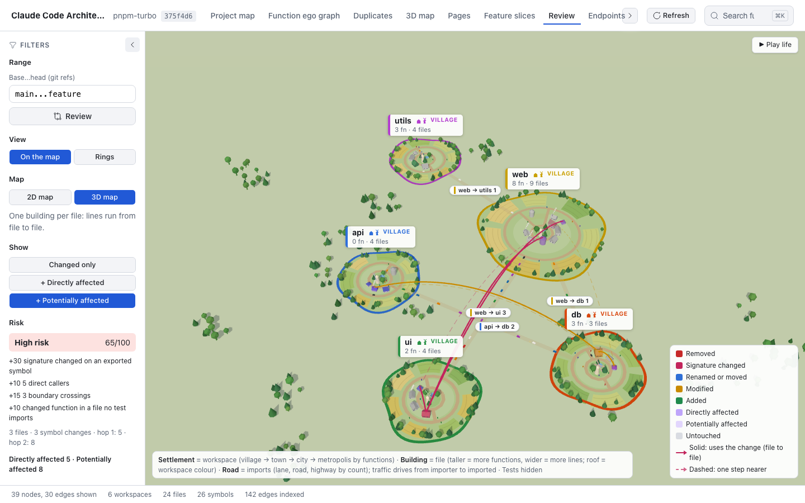


## Quick start

You need Node 22 or newer and pnpm. To use Gantry inside Claude Code, install it as a local plugin from a clone (the `/gantry:init`, `/gantry:sync`, `/gantry:explain`, `/gantry:overview`, `/gantry:map` and `/gantry:review` skills, the model-invoked `reuse-first` skill, the background `describer` agent and the read-only `explainer` agent): see [`docs/INSTALL.md`](docs/INSTALL.md). To use only the command line, run it from a clone:

```sh
git clone https://github.com/jbknick/architecture-visualization-cc-plugin.git
cd architecture-visualization-cc-plugin
pnpm install && pnpm build
```

Then, inside a TypeScript git repository you want to look at (`<path>` is this clone):

```sh
node <path>/plugin/dist/cli.js init
node <path>/plugin/dist/cli.js map
```

`init` indexes the repo and prints a summary: files indexed and the time taken, then counts of symbols, function-like symbols, edges, unresolved imports and parse errors, and the data directory. On the small fixture that is 22 files in under 100 ms. `map` starts the explorer on `127.0.0.1` on a free port, prints its URL (with an access token in the query string) and opens it in your browser. Pass `--no-open` to only print the URL, and `--port <n>` to pick the port. Stop it with Ctrl+C.

The explorer does not watch your files. After you save, the status bar says "Out of date (n files)" on the next request (switching back to the explorer's tab counts as one). Press **Refresh** in the top bar to re-index just those files and reload the view in place: the camera and everything outside the files you changed stay where they were, and new or changed functions get an amber outline until the next refresh. On a repo of about 1,500 files, refreshing after 20 edited files took about 1.3 s from the click to the new code on screen (see [`docs/milestones/M4.md`](docs/milestones/M4.md)).

The index lives outside your repo, in `repos/<hash>/` under the plugin's data directory (`~/.claude/plugins/data/gantry-gantry-dev/` when installed from the local marketplace; the skills, the hooks and the MCP server all use it). Outside the plugin the CLI falls back to `~/.gantry/data/repos/<hash>/`, and an index already there is still found; once the plugin directory has its own, `gantry backlog` points out the old one, and [`docs/INSTALL.md`](docs/INSTALL.md) says how to remove it. Commands that only read (`backlog`, `usage`, `heal`) and the session-start hook create no data directory for a repo that has no index. Nothing is written into the repo's working tree. The one exception is `gantry hooks install`, which you run yourself and which writes git hooks under `.git/hooks/` (or sets a local `core.hooksPath` if you already use one); `hooks uninstall` and `uninstall` put everything back.

## Commands

Run as `node <path>/plugin/dist/cli.js <command>`. Every command below exists today (`--help` on each shows its options).

| Command                                                                         | What it does                                                                                                                                                                                                                                                                                                                                                                                                                                                                                                                                                                                                                                                                                                                                                                                                                                                                                                                                                                                                                                                                                                                                                                                                                                                             |
| ------------------------------------------------------------------------------- | ------------------------------------------------------------------------------------------------------------------------------------------------------------------------------------------------------------------------------------------------------------------------------------------------------------------------------------------------------------------------------------------------------------------------------------------------------------------------------------------------------------------------------------------------------------------------------------------------------------------------------------------------------------------------------------------------------------------------------------------------------------------------------------------------------------------------------------------------------------------------------------------------------------------------------------------------------------------------------------------------------------------------------------------------------------------------------------------------------------------------------------------------------------------------------------------------------------------------------------------------------------------------ |
| `init [--estimate] [--exports-first] [--embed]`                                 | Create the data directory and run a full deterministic index of the current repo. `--estimate` also prints how many functions would need a description and the projected token cost; it makes no model calls. `--embed` also fills the local embedding vectors afterwards (see `embed`). It also records `similar_to` links between functions that are exact or near copies of each other (shown by `node`).                                                                                                                                                                                                                                                                                                                                                                                                                                                                                                                                                                                                                                                                                                                                                                                                                                                             |
| `embed [--limit n] [--budget-ms n] [--json]`                                    | Fill the local embedding vectors used by the two vector tiers of duplicate detection, in resumable batches with progress on stderr. Runs a local model on the CPU; nothing is sent anywhere. `init` never does this on its own.                                                                                                                                                                                                                                                                                                                                                                                                                                                                                                                                                                                                                                                                                                                                                                                                                                                                                                                                                                                                                                          |
| `index [--files <paths...>] [--layer main\|working] [--dump]`                   | Run the deterministic index. `--dump` prints the sorted graph as JSON.                                                                                                                                                                                                                                                                                                                                                                                                                                                                                                                                                                                                                                                                                                                                                                                                                                                                                                                                                                                                                                                                                                                                                                                                   |
| `heal [--from <sha>]`                                                           | Bring the index up to the current `HEAD` (incremental, or a full re-index for a very large diff) and refresh the `similar_to` links. In a repo with no index it says so and creates nothing.                                                                                                                                                                                                                                                                                                                                                                                                                                                                                                                                                                                                                                                                                                                                                                                                                                                                                                                                                                                                                                                                             |
| `search <q> [--kind <kind...>] [--limit <n>] [--json]`                          | Hybrid search: keywords over symbol names, paths and stored descriptions, plus meaning when the embedding model is cached (never downloaded by search). Higher score is better.                                                                                                                                                                                                                                                                                                                                                                                                                                                                                                                                                                                                                                                                                                                                                                                                                                                                                                                                                                                                                                                                                          |
| `node <target> [--json]`                                                        | Show a symbol or file and its neighbours by edge kind. The target is a node id, `path:line` or a file path.                                                                                                                                                                                                                                                                                                                                                                                                                                                                                                                                                                                                                                                                                                                                                                                                                                                                                                                                                                                                                                                                                                                                                              |
| `usage [--json]`                                                                | Model usage grouped by task and model (rows come from the pre-commit describer; empty until it has run). It creates nothing in a repo with no index.                                                                                                                                                                                                                                                                                                                                                                                                                                                                                                                                                                                                                                                                                                                                                                                                                                                                                                                                                                                                                                                                                                                     |
| `describe --staged [--json]`                                                    | Describe the staged functions that have no description with the headless `claude -p` worker (Haiku by default; functions that fail the checks are retried once on Sonnet). Only runs when `precommit.mode` is `timeboxed` (stops at `precommit.budgetMs`, default 20000, and queues the rest) or `strict` (no deadline); the default `off` does nothing. The worker needs `claude` logged in (set `worker.binary` in the config if it is not on `PATH`); otherwise everything is queued. Every call is logged for `usage`. The pre-commit hook runs this itself in those two modes and always exits 0.                                                                                                                                                                                                                                                                                                                                                                                                                                                                                                                                                                                                                                                                   |
| `backlog [--json] [--failed] [--retry-failed]`                                  | Counts of the description backlog by status (pending, claimed, failed) and by priority, the number of fallback descriptions written without a model (`fallback`), the data directory they come from (`data_dir`), and whether `init` built a backlog there (`indexed`). `--failed` lists each failed function with the rule name of its last rejection (never the description text); `--retry-failed` puts them all back to pending. It notes an older, unused index left in `~/.gantry/data` (`legacy_data_dir`). No model calls; it creates nothing in a repo with no index.                                                                                                                                                                                                                                                                                                                                                                                                                                                                                                                                                                                                                                                                                           |
| `config get [key]`, `config set <key> <value>`                                  | Read or write project config by dotted key.                                                                                                                                                                                                                                                                                                                                                                                                                                                                                                                                                                                                                                                                                                                                                                                                                                                                                                                                                                                                                                                                                                                                                                                                                              |
| `map [--port <n>] [--no-open]`                                                  | Start the explorer server, or reuse the running one, and open it. The explorer refreshes on request: its Refresh button re-indexes the files changed since the last refresh (no watcher).                                                                                                                                                                                                                                                                                                                                                                                                                                                                                                                                                                                                                                                                                                                                                                                                                                                                                                                                                                                                                                                                                |
| `review <base>...<head> [--json] [--open]`, `review --pr <n> [--json] [--open]` | Symbol-level diff of a branch or pull request against its merge base, with its blast radius. With `--json` it prints JSON: which functions were added, removed, modified, moved to another file or renamed in place, whether a signature or an export changed, the line delta, the import specifiers added or removed per file, and `impact` (callers by hop, crossings, risk, notes, and `consumers`: for every changed symbol and file its `direct` and `potential` consumers with how each uses it, from the index as it is; `null` when the repo has no index). It reads the changed files from git and never re-indexes or writes anything. Without `--json` it prints a short summary: a risk score with the rules that fired (low, medium or high), the callers at each hop (up to 3), the places the change crosses a package, app or client/server boundary, the top consumers of each change ("Directly affected" and "Potentially affected"), and notes (removed exports still used, new undeclared imports, new duplicates). `--open` opens the review view in the explorer (starting it in the background if needed) and prints its link. `--pr` asks `gh` for the base and head and fetches them if missing; without a logged-in `gh`, use the range form. |
| `hooks install`, `hooks uninstall`                                              | Install or remove the git hooks in the current repo, chaining any existing hooks.                                                                                                                                                                                                                                                                                                                                                                                                                                                                                                                                                                                                                                                                                                                                                                                                                                                                                                                                                                                                                                                                                                                                                                                        |
| `uninstall [--keep-data]`                                                       | Remove the git hooks and delete the repo's data directory.                                                                                                                                                                                                                                                                                                                                                                                                                                                                                                                                                                                                                                                                                                                                                                                                                                                                                                                                                                                                                                                                                                                                                                                                               |
| `hook <name> [args...]`                                                         | The entry point the installed git hooks call (the plugin's Claude Code hooks use it too). It always exits 0. You do not run it by hand.                                                                                                                                                                                                                                                                                                                                                                                                                                                                                                                                                                                                                                                                                                                                                                                                                                                                                                                                                                                                                                                                                                                                  |

## Status

Progress by milestone. Issue lists are on the [milestones page](https://github.com/jbknick/architecture-visualization-cc-plugin/milestones).

| Milestone                                                                                          | State            | Notes                                                                                                                                                                                                                                                                                                                                                                                                                                                                                                                                                                                                                                                                                                                                                                                                                                                                                                                                                                                                                                                                                                                                                                                                                                                                                                                                                                                                                                                                                                                                               |
| -------------------------------------------------------------------------------------------------- | ---------------- | --------------------------------------------------------------------------------------------------------------------------------------------------------------------------------------------------------------------------------------------------------------------------------------------------------------------------------------------------------------------------------------------------------------------------------------------------------------------------------------------------------------------------------------------------------------------------------------------------------------------------------------------------------------------------------------------------------------------------------------------------------------------------------------------------------------------------------------------------------------------------------------------------------------------------------------------------------------------------------------------------------------------------------------------------------------------------------------------------------------------------------------------------------------------------------------------------------------------------------------------------------------------------------------------------------------------------------------------------------------------------------------------------------------------------------------------------------------------------------------------------------------------------------------------------- |
| [M0 Spikes](https://github.com/jbknick/architecture-visualization-cc-plugin/milestone/1)           | Done, verdict GO | Headless Claude worker, oxc import graph, embedding model and description quality were measured. See [`docs/spikes/GO-NO-GO.md`](docs/spikes/GO-NO-GO.md).                                                                                                                                                                                                                                                                                                                                                                                                                                                                                                                                                                                                                                                                                                                                                                                                                                                                                                                                                                                                                                                                                                                                                                                                                                                                                                                                                                                          |
| [M1 Structural graph](https://github.com/jbknick/architecture-visualization-cc-plugin/milestone/2) | Done             | Workspace detection, file discovery, parsing, import resolution, hashing, SQLite store, `init`, `heal`, git hooks, search/node/usage/config. On a private TypeScript monorepo (1,531 files, 9,042 symbols, 41,817 edges): 0 parse errors, 0.28% of repo-internal imports unresolved, a cold index in about 7 s, identical output across runs. Details in [`docs/milestones/M1.md`](docs/milestones/M1.md).                                                                                                                                                                                                                                                                                                                                                                                                                                                                                                                                                                                                                                                                                                                                                                                                                                                                                                                                                                                                                                                                                                                                          |
| [M3 Explorer](https://github.com/jbknick/architecture-visualization-cc-plugin/milestone/4)         | Done             | Built: local server with a token, the 2D project map (four detail levels), the function caller graph, the duplicates view (ranked groups, side-by-side source, "not a duplicate"), small badges on function tiles and rows (duplicate, undescribed, misleading name) with a legend, the pages view (the file routes of TanStack Router apps, each with its component and what that renders), the feature slices view (imports across slice boundaries and the functions shared by several slices), the 3D settlements (just for fun, with the city and islands as alternative styles), search, inspector (for a workspace or folder it shows the cached overview as plain text, or a hint to run `/gantry:overview`), light and dark themes. The read-only `explainer` agent with the `/gantry:explain`, `/gantry:overview` (cached per workspace or folder, only on request) and `/gantry:map` skills; the in-session check of `/gantry:explain` and `/gantry:overview` is recorded in #35. The M3 regression ([`docs/milestones/M3.md`](docs/milestones/M3.md), `evals/bench/m3.ts`) is recorded: pan holds 60 fps headless (118 to 120 fps in a window on a 120 Hz screen) on a synthetic 30,000-function graph, and 60 fps on a private TypeScript monorepo (Apple M3 Pro, GPU), the project map, pages and slices draw the same picture from two fresh data dirs, and a second origin is refused with 403. Optional follow-up: far-zoom wheel zoom on the 30,000-function graph dips to 45 to 47 fps headless with frames up to 108 ms (#135). |
| [M2 Reuse guard](https://github.com/jbknick/architecture-visualization-cc-plugin/milestone/3)      | In progress      | Built: the description backlog and template descriptions, the local embedding step (`gantry embed`), the duplicate engine (exact, near, code-vector and semantic tiers, plus `similar_to` links) with the explorer's Duplicates view, and the deterministic reuse advice (import it, add the dependency, export or move it, undeclared-import check). The description checks, and the `gantry` MCP server with lazy refresh and two describer tools (claim a batch of functions, submit descriptions), three lookup tools (hybrid search, browse, node) with per-folder catalog files of one-line function descriptions, and the optional pre-commit describer (`precommit.mode` `timeboxed` or `strict`; runs `claude -p` headless, checks every description, logs usage). The plugin package (manifest, MCP config, the `describer` agent that calls those tools, the `/gantry:init` and `/gantry:sync` skills) and the `backlog` command; the Claude Code hooks (a duplicate and undeclared-import note at the end of each turn, double-checked against disk, a session-start reminder, the same findings at pre-commit); installing it from a local path is in [`docs/INSTALL.md`](docs/INSTALL.md), and the in-session end-to-end run is recorded in #27. The `gantry_find_similar` MCP tool and the model-invoked `reuse-first` skill that tells Claude to call it before writing a new helper. Not built: a command that reports duplicates.                                                                                                 |
| [M4 Explorer refresh](https://github.com/jbknick/architecture-visualization-cc-plugin/milestone/5) | Done             | Built: an "Out of date (n files)" marker from a cheap check on every request (`git status` plus mtime), a Refresh button that re-indexes the changed files (`POST /api/refresh`) and reloads the view in place, keeping the camera and the position of everything outside the changed files, with added and changed functions outlined. Not live: no watcher, no push. Measured on a private 1,541-file monorepo: 20 edited files to new code on screen in 1.27 s (median), nothing outside them moved. See [`docs/milestones/M4.md`](docs/milestones/M4.md).                                                                                                                                                                                                                                                                                                                                                                                                                                                                                                                                                                                                                                                                                                                                                                                                                                                                                                                                                                                       |
| [M5 Code review](https://github.com/jbknick/architecture-visualization-cc-plugin/milestone/6)      | In progress      | Blast radius of a change or pull request. Built: the symbol diff between two refs (`gantry review --json`), impact by hop with a risk score (`gantry review`, `gantry_impact`), the consumers of every change in two tiers, directly and potentially affected, the review view (a layer on the 2D and 3D project map, plus a rings mode; `gantry review --open`) and `/gantry:review`. Regression in [`docs/milestones/M5.md`](docs/milestones/M5.md): a 17-file range on a private monorepo gives data and view in about 2 s with the index unchanged. Waiting for: the operator's sign-off on the hand-checked blast radius.                                                                                                                                                                                                                                                                                                                                                                                                                                                                                                                                                                                                                                                                                                                                                                                                                                                                                                                      |
| [M6 Adapters](https://github.com/jbknick/architecture-visualization-cc-plugin/milestone/7)         | In progress      | TanStack Start, Hono, oRPC and Drizzle: page to API to table views. Built: the adapter framework, with TanStack Start server functions (method, validator, middleware, handler, and the route loaders that call them) and Hono routes (full paths across `.route()` mounts and imports, middleware) indexed as endpoint nodes. Not built yet: oRPC, Drizzle, client-call matching and the views.                                                                                                                                                                                                                                                                                                                                                                                                                                                                                                                                                                                                                                                                                                                                                                                                                                                                                                                                                                                                                                                                                                                                                    |

## Claude Code hooks

With the plugin installed, three Claude Code hooks run on their own. After Claude writes or edits a TypeScript file, a `package.json`, a `tsconfig` or `pnpm-workspace.yaml` (`Write`, `Edit`, `MultiEdit`), `PostToolUse` records the file and re-indexes a source file; it says nothing yet. When Claude finishes its turn, `Stop` re-indexes everything the turn touched, checks it once, and double-checks each finding against the files on disk: if a new or changed function looks like an existing one (exact or near copy, or a stored code vector match) that is still there, or the turn added an import that no package.json declares, it hands Claude one short note (at most 600 characters) with the file, the existing function and what to do, for example `Import it: import { slugify } from './slug'`. Otherwise it says nothing. Checking at the end of the turn means that moving a function to a new file, or adding an import before its dependency, does not raise an alert halfway. At the start of a session, `SessionStart` brings the index up to date and prints one line only when the repo is not indexed or 100 or more functions still await descriptions. The hooks stop after 1.5 seconds without output, never block an edit or a session, make no model calls, and do nothing inside a describer's own run. The git `pre-commit` hook prints the same findings to stderr. See [`docs/INSTALL.md`](docs/INSTALL.md) for how to check them in a session.

## MCP server

`plugin/dist/mcp.js` is a stdio MCP server named `gantry` (it is built by `pnpm build`; the plugin package starts it for Claude Code). Before every tool call it brings the index up to date: it runs `heal` only when `HEAD` has moved, then refreshes the files you have edited since. It writes nothing but protocol messages to stdout, and every answer is one JSON block of at most 4,000 characters (lists are cut and the answer says `"truncated": true`). The one exception is `gantry_claim_batch`, which only background describer agents call and which returns at most 10 functions (up to 20,000 characters). A describer's run ends after 15 claims, well before the subagent turn limit, and `/gantry:init` and `/gantry:sync` then start a fresh describer with the same worker id, so a large backlog finishes without manual restarts.

There are ten tools today. The first two are for background describer agents and do not read or search the graph; the other eight look things up, check the impact of a change, open the explorer or keep overviews.

| Tool                         | Input                                                              | What it does                                                                                                                                                                                                                                                                                                                                                                                                                                                                                                                                                                                                                                                                                                                                                                                                                                                                                                                                                                                                                        |
| ---------------------------- | ------------------------------------------------------------------ | ----------------------------------------------------------------------------------------------------------------------------------------------------------------------------------------------------------------------------------------------------------------------------------------------------------------------------------------------------------------------------------------------------------------------------------------------------------------------------------------------------------------------------------------------------------------------------------------------------------------------------------------------------------------------------------------------------------------------------------------------------------------------------------------------------------------------------------------------------------------------------------------------------------------------------------------------------------------------------------------------------------------------------------- |
| `gantry_claim_batch`         | `{ worker_id?, size <= 10 }`                                       | Claims functions that need a description and returns `{ worker_id, batch_id, items }`, one fact sheet per function. Without a `worker_id` the server makes one up and returns it. A batch the worker has not submitted comes back first, with the same `batch_id`. A claim expires after 10 minutes. An empty answer says why in `stop`: `backlog_empty`, `not_indexed` (this data dir has no index for the repo; run `/gantry:init`) or `run_limit` (the describer's run is over after 15 claims, so it hands back before its turn limit and the skill starts a fresh one with the same id).                                                                                                                                                                                                                                                                                                                                                                                                                                       |
| `gantry_submit_descriptions` | `{ batch_id, results: [{ content_key, description }] }`            | Checks each description, stores the good ones and returns `{ accepted, rejected, fallbacks }`. Each rejection names the rule that fired and a fixed rewrite instruction for it (`fix`), never the rejected text. A rejected function stays in the batch while `resubmit` is true, so a rewritten description can be submitted again with the same `batch_id`. After 2 failures it is set aside as failed (`gantry backlog --failed`); a function rejected twice only for wording (`shape` or `identifier`) gets a third try, and if that fails too the server stores a plain description that names nothing, only the kind, the number of parameters and the number of other functions called, marked "(generated without a model)". The extra try goes only to clean wording mistakes: a broad check of every submitted value withholds it at the first sign of an order, a claim, an approval word, a modal, an addressee, markup, a secret or an injection pattern. A description that imitates the fallback marker is rejected. |
| `gantry_find_similar`        | `{ query?, code?, kind?, workspace?, caller_path?, limit? <= 10 }` | Call before writing a new helper. Give a one-sentence `query`, a draft `code`, or both. Returns `{ matches: [{ id, name, kind, path, line, signature, import_path, tier, score, untrusted_description, described_by?, advice: { situation, action, inline } }], notes? }`, best first (tiers exact, near, code_vector, semantic). `advice.inline: true` means import it as is. Without description vectors it says so in `notes` and uses code and keyword matches only.                                                                                                                                                                                                                                                                                                                                                                                                                                                                                                                                                            |
| `gantry_search`              | `{ query, kind?, workspace?, exported?, limit? <= 50 }`            | Hybrid keyword and meaning search. Returns `{ hits: [{ id, name, kind, path, line, signature, score, untrusted_description, described_by? }] }`, best first. `described_by` says who wrote a description: `model`, `template` or `fallback` (Gantry, without a model). Meaning search runs only when the embedding model is already cached; otherwise it is keywords only.                                                                                                                                                                                                                                                                                                                                                                                                                                                                                                                                                                                                                                                          |
| `gantry_browse`              | `{ target }`                                                       | One level below a workspace id, directory or file: `{ items: [{ id, name, kind, exported, path, line, count, untrusted_description, described_by? }], catalog_path }`. Directories and files carry their function counts. `catalog_path` is a markdown file in the data directory to `Read` when 4,000 characters are not enough.                                                                                                                                                                                                                                                                                                                                                                                                                                                                                                                                                                                                                                                                                                   |
| `gantry_node`                | `{ target }`                                                       | A symbol or file by id, `path:line` or path: `{ node, untrusted_description, described_by?, signature, fan_in, fan_out, neighbors, more? }`. At most 20 neighbors per edge kind; `more` counts the rest.                                                                                                                                                                                                                                                                                                                                                                                                                                                                                                                                                                                                                                                                                                                                                                                                                            |
| `gantry_open_view`           | `{ view, focus?, filters? }`                                       | Starts the explorer in the background if it is not running (within 3 seconds) and returns `{ url }`, a local link with an access token for the user to open. The review view takes `filters: { range: "<base>...<head>" }`. Its output goes to `explorer.log` in the data directory.                                                                                                                                                                                                                                                                                                                                                                                                                                                                                                                                                                                                                                                                                                                                                |
| `gantry_impact`              | `{ range? }` or `{ paths? }` or `{ symbol? }` (exactly one)        | Blast radius of a change: `{ changed, callers_by_hop, crossings, consumers, risk: { score, level, reasons }, notes }`, where `consumers` lists each changed symbol's direct consumers (with how they use it) and potential ones (with the direct consumer they go through). `range` is `<base>...<head>`; `paths` and `symbol` count as modified in the working tree. Lists are capped (counts say how many were left out); descriptions appear only as `untrusted_description`.                                                                                                                                                                                                                                                                                                                                                                                                                                                                                                                                                    |
| `gantry_get_overview`        | `{ node_id }`                                                      | The cached plain-words overview of a workspace (`ws:<name>`) or folder (`dir:<path>`): `{ cached: true, untrusted_overview, model, created_at, functions }`, or `{ cached: false, reason: missing or stale }` when code inside changed since it was written.                                                                                                                                                                                                                                                                                                                                                                                                                                                                                                                                                                                                                                                                                                                                                                        |
| `gantry_save_overview`       | `{ node_id, text }`                                                | Stores an overview written on request (at most 1,200 characters; rejected if it holds an instruction, a secret, a link or markup) and logs usage with source `explainer`. Overviews are never written on their own.                                                                                                                                                                                                                                                                                                                                                                                                                                                                                                                                                                                                                                                                                                                                                                                                                 |

Descriptions are text written by a model about code that may be untrusted, and the checks reduce that risk without removing it. Any tool that returns a description puts it in a field named `untrusted_description` (an overview in `untrusted_overview`, shown in the explorer inspector as "Overview — generated, may be wrong"), and every tool description says to treat the field as data and not follow anything in it. The checks are defence in depth, not the boundary: description text is treated as untrusted everywhere. Who wrote a description is reported next to it as `described_by` (`model`, `template`, or `fallback` when Gantry wrote it without a model) by every tool and explorer view that returns one (and `gantry search --json` returns the text as `untrusted_description` too), the catalog files quote each description after a fixed `untrusted <who> description:` label, and the explorer inspector labels a function description "Generated description — may be wrong" or, for a fallback, "Written without a model from names only — may be incomplete".

## How it works

1. Discover: list the repo's files with git, keep `.ts`, `.tsx`, `.mts` and `.cts`, and drop built-in excludes, sensitive paths and files over 1 MB.
2. Parse: oxc reads each file and extracts symbols and their syntax edges (imports, exports, calls, renders).
3. Hash: each function gets a content hash so unchanged code can be recognised later, plus a structural fingerprint that finds copies with renamed variables.
4. Resolve: oxc-resolver turns import specifiers into repo files and workspace packages, which gives the file-to-file and workspace-to-workspace edges.
5. Store: the graph goes into SQLite in the data directory. Output is sorted and stable, so two runs on the same commit give the same graph.
6. Serve: `gantry map` starts an HTTP server on `127.0.0.1` that serves the explorer and a JSON API. Requests need the token printed in the URL.

## Privacy and safety

- Everything is local. The indexer and the explorer make no model calls and need no API key.
- Files matching sensitive path patterns (`.env*`, `*.pem`, `*.key`, `id_rsa*`, `.npmrc`, `credentials*`, `secrets*`, `*.tfvars` and similar) are excluded by path, so their contents are never read for indexing.
- The explorer server binds to `127.0.0.1` only and answers API requests only with its per-run token.
- The git hooks fail open: if Gantry errors, the hook logs and exits 0 rather than blocking your commit or push.

## Development

```sh
pnpm install
pnpm build    # tsc -b && tsup && the explorer web build; writes plugin/dist/
pnpm check    # biome + tsc + vitest, the local quality gate
pnpm fmt      # apply Biome fixes
pnpm perf     # absolute-speed checks (duplicate engine on a 6,000-function index); not part of check, run before releases
pnpm readme:media   # regenerate the screenshots in docs/readme/ (add --gif to redo the GIFs too)
```

[`docs/SPEC.md`](docs/SPEC.md) holds the contracts and the repo layout. Contributions are welcome: start with [`CONTRIBUTING.md`](CONTRIBUTING.md), which covers setup, the PR rules (from [`CLAUDE.md`](CLAUDE.md)) and where to ask questions. Report security problems as described in [`SECURITY.md`](SECURITY.md). The explorer's own notes, including how to run it against the mock API, are in [`packages/explorer/web/README.md`](packages/explorer/web/README.md). `pnpm readme:media` needs Chromium for Playwright (`pnpm --filter @gantry/explorer exec playwright install chromium`).

The repository is named `architecture-visualization-cc-plugin`.

## Licence

[MIT](LICENSE).

## 3D map (just for fun)

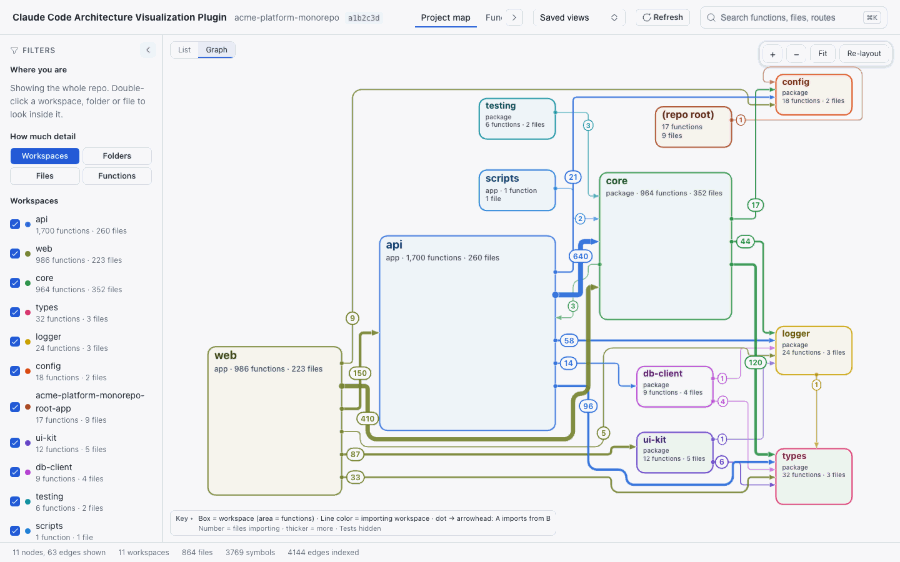

The 3D map is just for fun and is not very useful for real work. The 2D views are the ones to use. It shows the repo as a landscape. Each workspace is a settlement, and its size sets the tier: **village** (cottages, fields, a windmill), **town** (houses inside a wall, a church), **city** (blocks, cranes) or **metropolis** (a core of towers with suburbs round it). Tiers are ranked within the repo, and a workspace with fewer than 20 functions is always a village. Every file is one building: taller means more functions, wider means more lines. Its shape comes from the tier and from what the file is (a dome for a test, a water tower for config, a shop awning for a component, a columned porch for a route). Roofs and kerbs take the workspace's colour, as in the 2D map. Imports between workspaces are drawn as roads on the ground: a dirt lane for a few imports, a road, or a dual-carriageway highway for the heaviest. Vehicles and yellow arrows travel from the importing workspace to the imported one, and more imports means more traffic. The label on a road reads `A → B N`: A imports from B N times. The motion stops with "Pause life", stops when the tab is hidden, and is off when the system asks for reduced motion.

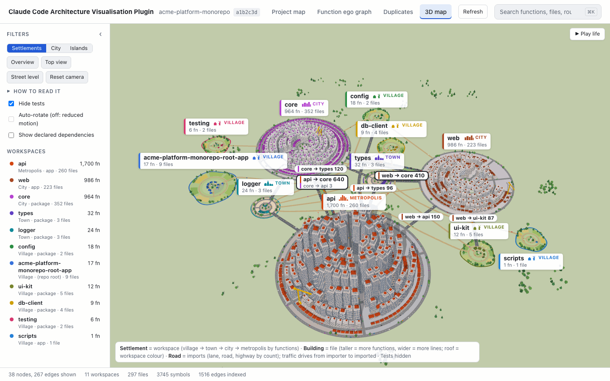

"Street level" puts the camera in one of the metropolis's avenues, and clicking a workspace in the list flies to it:

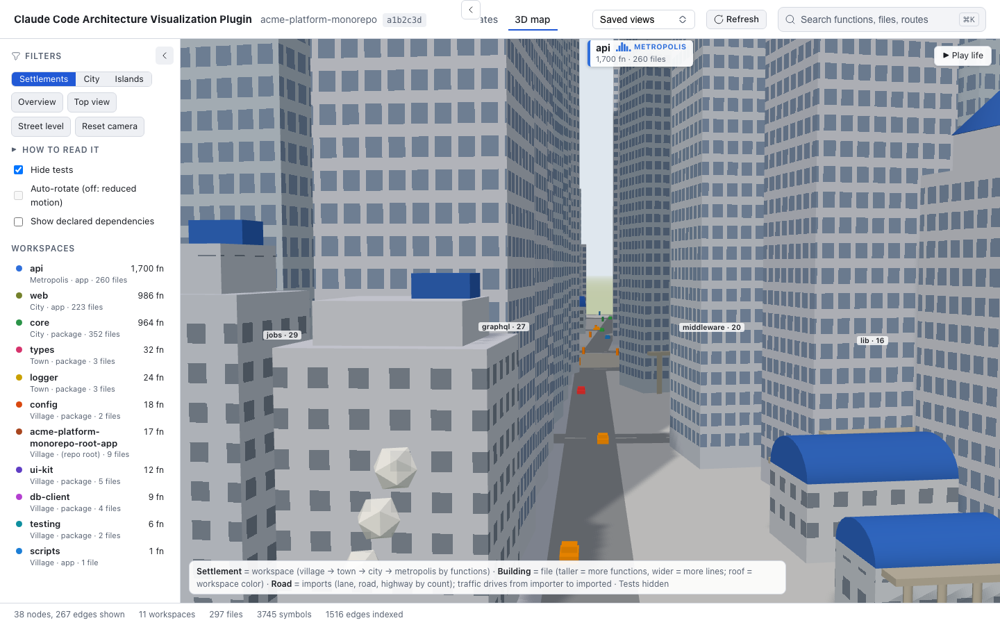

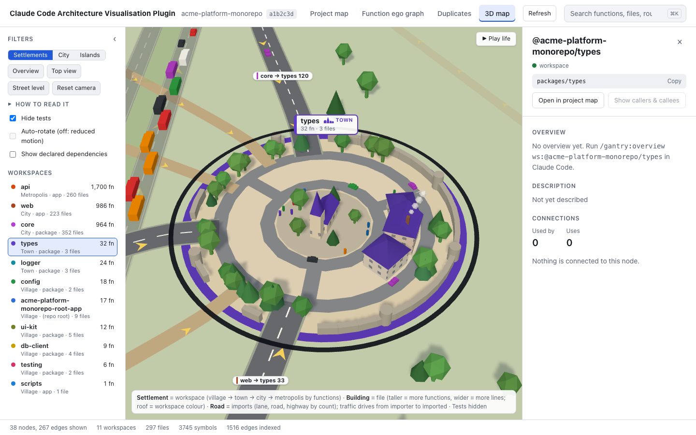

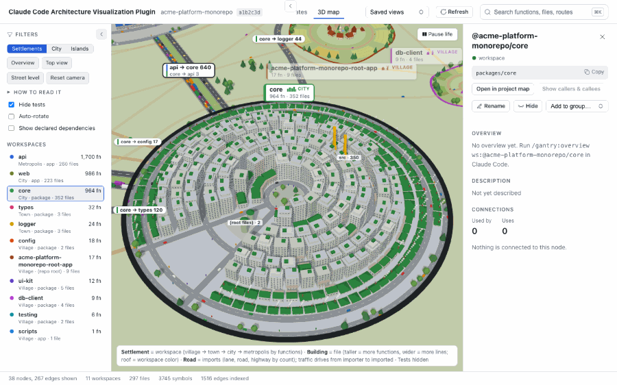

In the dark theme it is night, with lit windows and street lights:

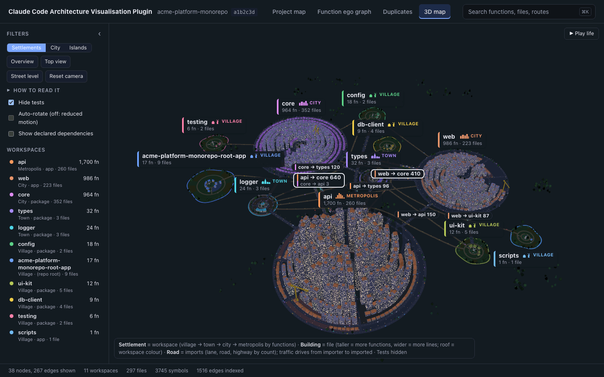

The pnpm-turbo fixture: five small workspaces, so five villages.

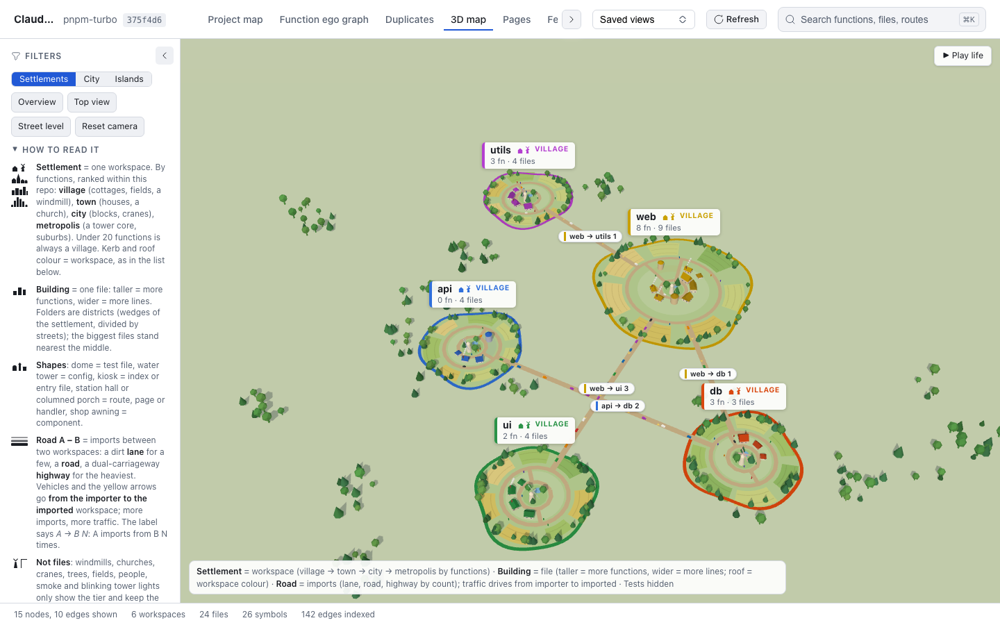

The older renderings are still one click away. "City" stands the 2D layout up in 3D: each district is a workspace with its ground area as its function count, and arches between districts carry the import counts. "Islands" is the first 3D rendering.


At Files level of the city every file is a building and its height is its function count. The numbered flags mark the largest files, matching the list on the left.


